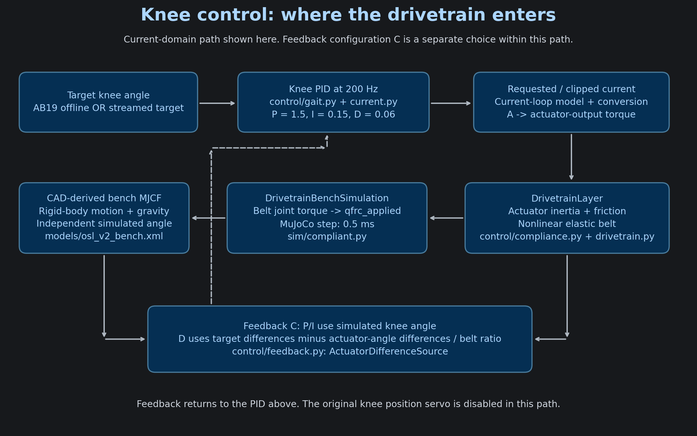
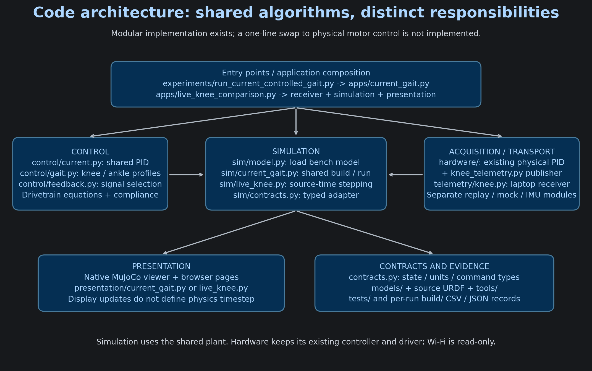
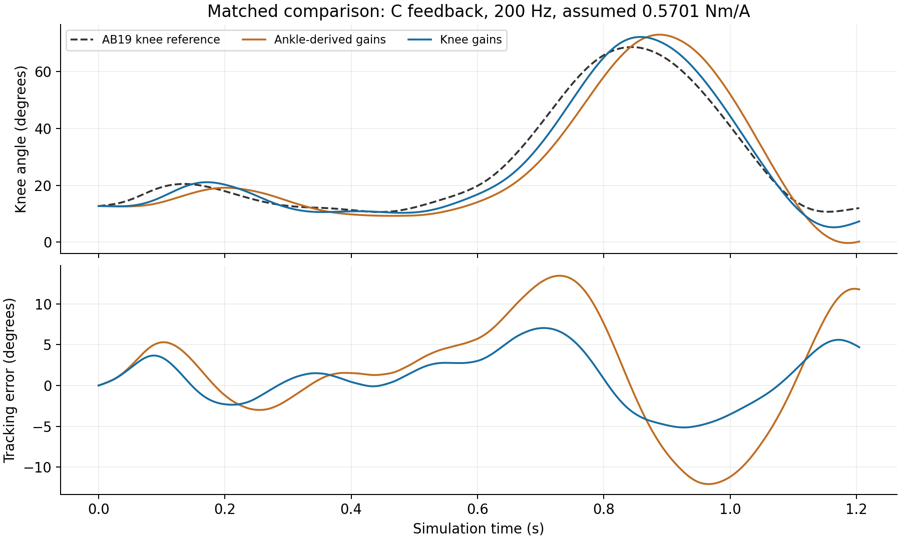
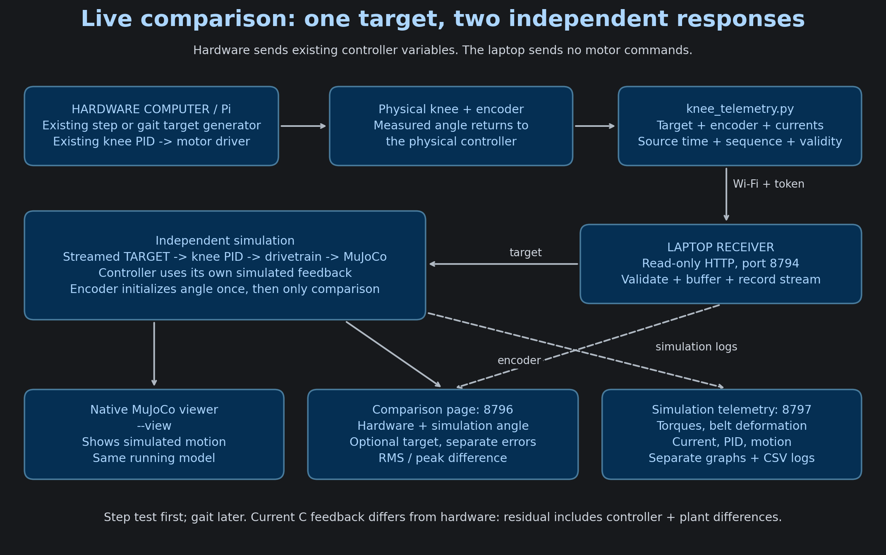

# OSL knee bench: project briefing and hardware validation plan

Prepared 30 October 2026. Purpose: explain the implemented work, demonstrate it, and agree which evidence can support the bench-model paper.

## 1. Start with this explanation

> I built a CAD-derived MuJoCo bench model and connected it to an explicit actuator and compliant-belt model. I first established a reproducible simulation baseline, then investigated feedback location and replaced ankle-derived tuning with the supplied knee gains. The software now separates controller configuration, dynamics, simulation, telemetry and presentation. We can stream the physical controller's target to an independently evolving simulation and compare its knee angle with the encoder while recording the simulation's internal variables. The software pipeline has been tested locally; the physical comparison is the next validation step.

The present experiment is a **fixed-base knee bench**. It does not simulate human balance, stance loading or complete walking. The offline AB19 knee-angle reference is human gait data; replaying it is not a hardware validation experiment. In the live experiment the target comes from the hardware controller, not AB19. The first physical test uses a step, so call it a **step-response comparison**, not a gait cycle.

## 2. What was developed, in order

| Stage | Work and evidence | What it establishes |
|---|---|---|
| CAD conversion | Untouched URDF and meshes -> `tools/oslcad.py` and `tools/build_mjcf.py` -> MJCF; frame and inertia audits in `docs/CAD_FINDINGS.md` | A traceable independent model-construction pipeline |
| Bench baseline | Fixed-base knee/ankle model, AB19 knee reference, original position-servo benchmark and saved oracle | A repeatable simulation reference, not physical accuracy |
| Drivetrain integration | Explicit actuator state, inertia, friction and nonlinear belt; torque applied to the MuJoCo knee | Internal transmission dynamics and observable belt quantities |
| Diagnostic experiments | Feedback-location, derivative-estimator and timestep investigations | High-frequency torque depends strongly on loop wiring and numerical treatment |
| Knee controller | Supplied gains, integral bound and 200 Hz rate; separate ankle/knee profiles sharing PID code | Correct tuning provenance and controlled comparisons |
| Software structure | `control/`, `sim/`, `telemetry/`, `presentation/`, `apps/`; typed units and state boundary | Clearer ownership, reusable simulation and display code |
| Live comparison | Controller-side publisher, receiver, independent simulation, two dashboards and recordings | Infrastructure for measuring hardware/simulation discrepancy |
| Physical validation | Not yet demonstrated in this work | Next experiment; no measured sim-to-real result claimed yet |

The detailed equations were adopted from published work, the knee gains were supplied, and the geometry came from OSL CAD. The contribution is the implementation, integration, experimental analysis and validation evidence, with those sources credited.

## 3. Overall control flow



The controller and the drivetrain have different jobs. The PID chooses current from angle error. The drivetrain predicts how that current moves the actuator and loads the belt. MuJoCo calculates the rigid-body knee response to the transmitted joint torque.

At each controller update, the selected profile supplies gains and rate. Between updates the current command is held. The current-loop model and `ConversionAudit` convert the command to the convention expected by the drivetrain; this prevents applying the gearbox factor twice. The drivetrain evaluates friction, actuator acceleration and belt deformation. The transmitted knee torque enters `qfrc_applied`; the original knee position servo is disabled in this path. MuJoCo advances at 0.5 ms. The viewer is a display of that same simulation, not another physics model.

For feedback C, with angles expressed in degrees and actuator angle referred through the belt ratio:

```text
e[k] = target[k] - simulated_knee[k]
P = Kp * e[k]
I = Ki * bounded_integral(e * controller_dt)
D = Kd * (difference(target) - difference(actuator_angle / belt_ratio)) / controller_dt
requested_current = P + I + D          (with the configured sign convention)
applied_current = clip(requested_current)
```

The integral bound is 50 degree-seconds. At Ki = 0.15 it bounds the integral contribution to 7.5 A before total-current clipping. First-sample derivative handling and reset state also matter. In the supplied physical script, D uses the difference of **knee error**; C is our simulation adaptation. Matching only Kp/Ki/Kd does not match these two control laws.

There are two unrelated A/B/C naming schemes in older files:

| Overall execution path | How it drives the model |
|---|---|
| Position-servo benchmark (path A) | Original MuJoCo position actuator; no explicit compliant-drivetrain path |
| Torque-domain PD (path B) | Torque PD -> current conversion -> compliant drivetrain -> knee torque |
| Current-domain PID (path C) | Current PID -> current-loop/conversion -> same compliant drivetrain -> knee torque |

Within the current-domain path, **feedback A** uses knee differences, **feedback B** uses instantaneous actuator velocity, and **feedback C** uses sampled actuator-angle differences for D. P/I remain knee-side. Say “current-domain path with feedback C” to avoid confusion. Drivetrain integration “Option C” is another historical label; it does not mean a controller gain profile.

## 4. Code architecture and the shared-wrapper proposal



The supplied three-page `Downloads/structure doc.pdf` proposes `RobotInterface.read_sensors()` and `send_commands()`, implemented by `MujocoSimulationRobot` and `PhysicalRobot`, with an unchanged controller loop selecting either backend. It is a conceptual design, not an implementation already present here.

| Proposal | Current implementation | Remaining difference |
|---|---|---|
| Separate control from robot access | PID in `control/current.py`; profiles/source in `control/gait.py`; physics in `sim/` | Existing callable and feedback-layer coupling remain |
| Explicit state and command interface | `contracts.py` and `sim/contracts.py` carry units, frames, validity and command conventions | Typed adapter covers the production current-gait path, not every legacy path |
| Simulation wrapper | `DrivetrainBenchSimulation`, shared `sim/current_gait.py`, live `LiveKnee` | Not the exact `RobotInterface` class in the proposal |
| Physical wrapper | Controller-side telemetry + `KneeReceiver` reads physical observations | No common motor-command backend; physical driver/controller stay on the hardware host |
| One-line sim/real switch | Knee/ankle configuration selection works with one shared simulation | Switching a controller to command physical hardware is not implemented |
| Same controller in parallel | Same knee gains and shared simulated plant/runtime | Hardware derivative, timing, limits and initialization must still be reconciled |
| Separate visualization/logging | `presentation/` plus application-owned CSV/JSON recording | Existing replay and live modes have different lifecycles |

**Accurate answer to “is it plug and play?”:** controller profiles are selectable and the simulated drivetrain is reusable across the torque/current paths. The system is modular, but hardware and simulation are not yet interchangeable backends. `sim/live_knee.py` also imports the current-gait argument parser from `apps/`, a remaining dependency to clean up later. This briefing does not change that architecture.

The proposal's sample `data.ctrl[:] = torques` cannot be copied directly: our authored MJCF has position actuators, and the compliant path intentionally applies joint torque after the drivetrain. Likewise the hardware driver's method name alone does not establish whether its argument is torque or current.

Useful code tour:

1. `experiments/run_current_controlled_gait.py`: compatibility launcher, not an empty controller.
2. `oslbench/apps/current_gait.py`: CLI selection and application composition.
3. `oslbench/control/gait.py`: `ANKLE_CONTROLLER_CONFIG`, `KNEE_CONTROLLER_CONFIG`, source construction.
4. `oslbench/control/current.py` and `feedback.py`: shared PID and feedback C.
5. `oslbench/control/compliance.py`: `DrivetrainLayer`; `drivetrain.py`: parameters and equations.
6. `oslbench/sim/current_gait.py` and `compliant.py`: shared build, stepping, plant coupling.
7. `oslbench/apps/live_knee_comparison.py`: receiver + simulation + viewer + two dashboards + recording.

## 5. Controller comparison: what actually improved

Historical results below are read from `build/knee_controller_selection/comparison.json`. They are saved simulation results, not new hardware measurements. The gait reference, model and physics timestep were fixed in this comparison.

| Case | Feedback | Hz | Effective constant Nm/A | RMS / peak error deg | Best-fit lag ms | Peak belt torque at knee Nm | Peak requested / applied A |
|---|---|---:|---:|---:|---:|---:|---:|
| Original ankle gains | A | 1000 | 0.855 | 4.469 / 9.479 | 22.5 | 140.265 | 12.487 / 12.487 |
| Same ankle gains | C | 1000 | 0.855 | 4.524 / 9.234 | 22.0 | 18.507 | 7.745 / 7.745 |
| Knee gains only changed | C | 1000 | 0.855 | 2.186 / 4.685 | 10.0 | 18.653 | 8.557 / 8.557 |
| Then rate changed | C | 200 | 0.855 | 2.215 / 4.794 | 9.5 | 19.266 | 8.976 / 8.976 |
| Current knee profile | C | 200 | 0.5701 | 3.394 / 7.055 | 15.5 | 19.042 | 12.372 / 12.372 |
| Ankle gains, matched rate/constant | C | 200 | 0.5701 | 6.846 / 13.465 | 35.5 | 19.472 | 11.161 / 11.161 |

Ankle gains: Kp 0.75 A/degree, Ki 0, Kd 0.03 A/(degree/second). Knee gains: Kp 1.5, Ki 0.15 A/(degree-second), Kd 0.06 in the same derivative units. All listed cases report zero clipping duration. Peak belt torque here is joint-side transmitted drive torque, not a measured hardware torque or a complete human knee moment.

The matched-rate/constant comparison reduces RMS from 6.846 to 3.394 degrees, about 50%. It changes all three gains together, so it does not isolate the benefit of Ki alone. Changing feedback A to C accounts for the large torque reduction in the original-gain pair; it was not caused by the later knee-gain change. The lowest RMS case uses a different constant and rate from the current knee profile and should not be presented as hardware-matched tuning.



Keep C as the present demonstration setting. Investigate a fully matched hardware-law simulation separately before restoring knee-only derivative feedback: previous simulations with knee gains and that feedback developed severe oscillation and exceeded the belt fit range. Do not tune the physical controller to conceal this simulation problem.

## 6. Live data flow: what is measured and what is simulated



The encoder is already read by the hardware controller. We publish its existing calibrated `actual_deg`, the generated `reference_deg`, requested current, clamped current, source time, sequence and validity. A second encoder-reading process is unnecessary. The telemetry server runs inside the controller process with networking in background threads. The laptop polls read-only HTTP on port 8794; both computers use the same token.

The laptop uses the **target** as input to its own controller. The encoder initializes simulated knee angle once; later encoder values are used for comparison, not continuous state replacement. The simulation calculates its own P/I/D, current, actuator motion, belt deformation and torques. Hardware requested/clamped current is not measured current, and modelled belt torque is not a hardware torque observation.

Three views serve one live run:

- Native MuJoCo window (`--view`): independent simulated motion.
- Browser 8796: hardware and simulation angle on one graph, optional target, and separate errors.
- Browser 8797: simulation torques, belt deformation/energy/stiffness, currents, PID terms and motion; grouped plots with labels.

Display pause freezes a page only. Acquisition and CSV recording continue. “Stop laptop run and save” stops the laptop application; it does not stop the physical controller. The two dashboards use the same session, not two separate simulations. The earlier CSV replay and six-observation mock dashboards remain separate diagnostic tools; neither should be used as the main hardware-comparison demonstration.

Every new `--outdir` contains `metadata.json`, `hardware_batches.jsonl`, `simulation.csv`, `comparison.csv`, and final `summary.json`. The shell command supplies the timestamp; the application refuses an existing folder. Hardware retains its own CSV as a second record.

Source timestamps drive the simulated timeline. The 100 ms delivery buffer and display refresh can delay what is visible; they are not physical phase lag. Gaps after initialization, clock/session changes and invalid ordering stop or reject the affected run rather than inventing missing targets. Invalid encoder observations are excluded from paired error metrics. Initial velocity and belt deformation are assumed zero. At shutdown, pending/unprocessed samples and missing tail data must be checked before using a run as complete evidence.

## 7. Model provenance: what differs from MyoAssist

The custom model was generated from `osl_v2_0_assembly/urdf/osl_v2_0_assembly.urdf`, not by renaming the MyoAssist model. The CAD audit reports 682 links, 681 joints, 657 inertial blocks with only 14.7534 grams total exported mass, and 52 non-positive inertia tensors. The conversion resolves link transforms, composes visual origins, groups rigid parts, assigns them to three segments, and reconstructs aggregate mass/COM/inertia from mesh volume and density rules. The untouched URDF and generator make this reproducible.

The raw recovered CAD total is approximately 4.955763 kg: knee-proximal 0.449846, shank 3.590758, foot 0.915159. The inspected MyoAssist OSL assembly total is approximately 5.377474 kg **including a 0.849991 kg socket**, or 4.527483 kg without it. Therefore a simple total-mass comparison is misleading: the raw CAD model is about 0.428 kg heavier than that socket-excluded model, despite being lighter than its socket-included total.

The generator sets `MOTOR_MASS = 0.0`; comments discuss missing actuator assemblies and possible residual mass. Treat those comments as an unresolved hypothesis, not a measured explanation for the difference. Densities, included parts, actual motor/gearbox mass, centre of mass and knee-axis inertia need checking on the bench. Do not add motor mass from the residual merely to force agreement. The existing joint armature also needs reconciliation with the explicit drivetrain inertia before physical identification.

The local MyoAssist inspection describes assembly meshes and actuator gains, whereas this implementation explicitly integrates the compliant drivetrain. More mesh parts do not imply more dynamic degrees of freedom or more accurate dynamics. Both have three moving-segment groupings in that comparison. Historical socket and human-device experiments are separate from the current fixed-base bench.

Sources: `tools/build_mjcf.py`, `tools/oslcad.py`, `docs/CAD_FINDINGS.md`, `docs/MYOASSIST_FINDINGS.md`, and `oslbench/sim/model.py`. Some older prose asserts a fidelity advantage or explains the mass gap too strongly; the qualified interpretation here should be used in the meeting. AI assistance in coding is part of the development workflow, not evidence that the model is physically valid.

## 8. Prior art and defensible paper contribution

This is a focused literature check, not an exhaustive novelty search. The exact conference manuscript and research question still need to be reviewed with the authors.

| Existing work | What is already established | How to position this project |
|---|---|---|
| Best et al., compensated impedance control, DOI 10.1109/TMECH.2024.3508469 | OSL v2 drivetrain dynamics and compensation are published; the local parameter audit credits their equations and fitted parameters | Credit those equations. Study their integration and predictive adequacy on this bench rather than claiming a new belt/friction law. The author's [dissertation, chapter 3](https://deepblue.lib.umich.edu/bitstream/handle/2027.42/199409/tkbest_1.pdf?isAllowed=y&sequence=1) provides primary-source context. |
| [MyoAssist](https://github.com/neumovelab/myoassist) | MuJoCo human-device simulations, controller optimization and an existing `OpenSourceLeg_KA_L1` device composition | Do not claim the first OSL MuJoCo model. Emphasize the independently derived bench model, explicit drivetrain path and reproducible comparison workflow. |
| [assist_sim](https://github.com/neumovelab/assist_sim) | Modular attachment of assistive devices to musculoskeletal models, returning a compiled MuJoCo model | Modular code and model composition alone are not new research claims. Our immediate scope is bench control/validation, not their human-device training problem. |

**Strongest candidate contribution:** a reproducible bench-level evaluation showing how explicit drivetrain dynamics and controller feedback choices affect the ability to predict the physical knee response under recorded inputs.

The model-construction audit, regression tests, frame/unit conversions and live recording system support that contribution. The online overlay is useful infrastructure; it measures discrepancy, it does not itself eliminate the sim-to-real gap. An implementation can be a substantial contribution to the team paper without every component being a new algorithm.

A concrete study question to propose:

> Under matched inputs and bench conditions, how much do explicit actuator friction, inertia and belt compliance improve knee-response prediction, and which remaining mismatch is explained by controller timing or feedback location?

Suggested evidence needed before making that claim:

1. Confirm hardware units, shaft conventions, encoder zero/sign, actual controller period, derivative, clipping and integral behavior. `0.5701 Nm/A` remains a provisional simulation assumption. Do not multiply it by the 9:1 gearbox blindly. Verify physical belt teeth; the CAD ratio 50/11 differs from the paper/script 4.61.
2. Capture repeatable step trials with timestamps and both requested/clamped current; add measured current if the driver provides a verified channel. Preserve warm-up, initial angle and load conditions.
3. Compare matching controller implementations, or clearly label controller differences as part of the residual. A separate offline current-input replay could help isolate plant response, but is not the currently implemented live mode; commanded current still differs from measured current.
4. Use an ideal-transmission model and a compliant model with the same input, constraints and initial conditions. The old position-servo oracle alone is not a fair plant ablation because its control formulation differs.
5. Identify uncertain parameters on a training set; evaluate on held-out amplitudes/speeds/trials. Report RMS, peak error, delay, variability, clipping and belt-fit violations. Do not fit and report on the same trial as independent validation.
6. Separate raw synchronized error from phase-aligned shape error. Do not time-shift away a real delay and call that better prediction. Test the gait controller only after the step pipeline is reliable.

## 9. Meeting order and decisions to obtain

Allow about 15 minutes for explanation before the physical test:

1. **2 minutes:** use the opening explanation and state fixed-base scope.
2. **3 minutes:** show control-flow and code-architecture diagrams; explain shared PID versus configuration and drivetrain versus controller.
3. **3 minutes:** show the saved comparison table and run the knee demo. Distinguish feedback-driven torque reduction from gain-driven tracking improvement.
4. **2 minutes:** compare the implemented architecture with the wrapper proposal honestly.
5. **3 minutes:** show synthetic live comparison, the native model, both dashboards and recorded files. Identify the synthetic label explicitly.
6. **2 minutes:** agree first hardware step test, then discuss the study question and paper fit.

Ask for the paper's current draft/title and intended contribution; confirm which bench assembly and operating conditions it describes. Ask whether the desired result is controller validation, model identification, or a reproducible bench platform. Agree contribution ownership with the team: model/software, experiment design, data collection, analysis and writing. Ask for the physical meaning of the torque constant, actual motor/current limits, encoder convention and the final gait-controller source.

Use [the accompanying demo and hardware commands](DEMO_AND_HARDWARE_2026-10-30.md). Do not change hardware gains merely to reproduce the lowest simulation RMS.

## 10. Verification record

The gains, module paths, live metadata and saved numeric comparison were checked against the current repository. On 30 October the focused integrated-simulation and telemetry tests passed **19/19**, including live feedback independence, sample timing, dashboard controls and local HTTP transport. The first sandboxed transport attempt was blocked by Windows socket permissions; the rerun outside the sandbox passed. These are local software tests, not a physical Wi-Fi or actuator test. The live browser was not visually revalidated in this review.

The existing full regression suite also passed **269/269 with real MuJoCo**, after rerunning outside the socket-restricted sandbox. The focused 19 tests are separate from that runner. Passing these checks verifies software behavior and regression expectations, not hardware fidelity.

No production controller, model, hardware gains, reference trajectory or saved experiment results were changed for this briefing. Diagrams are reproducible with `docs/assets/research_briefing/make_diagrams.py` and are available as PNG and SVG.
