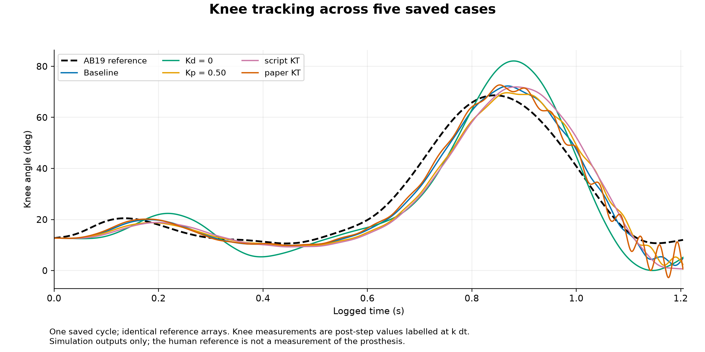
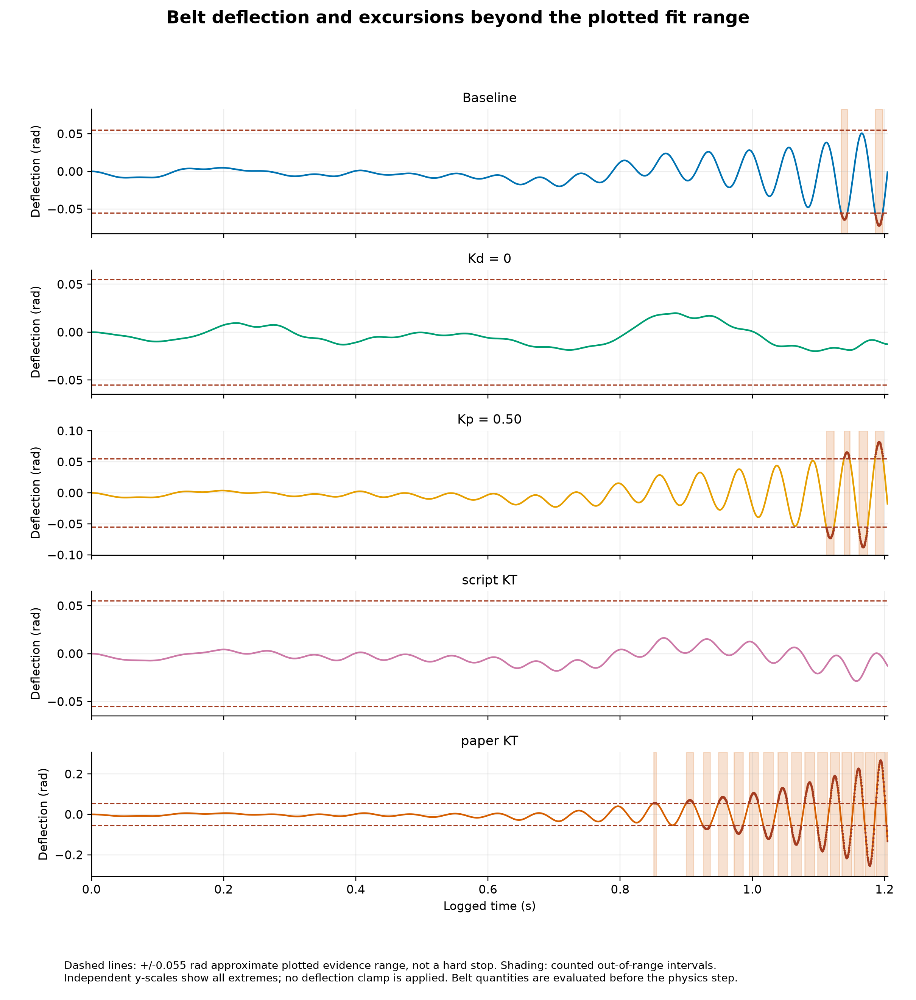
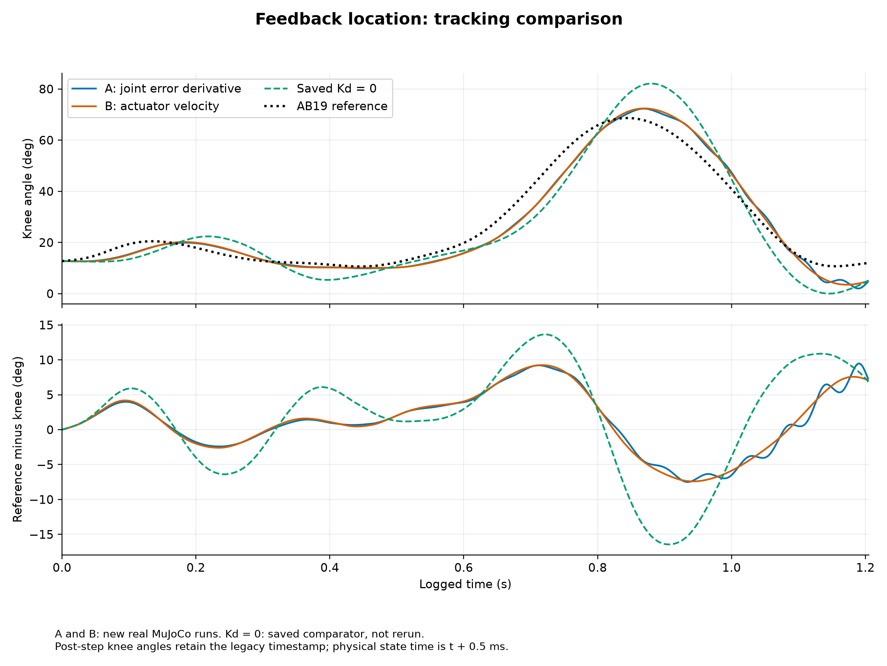
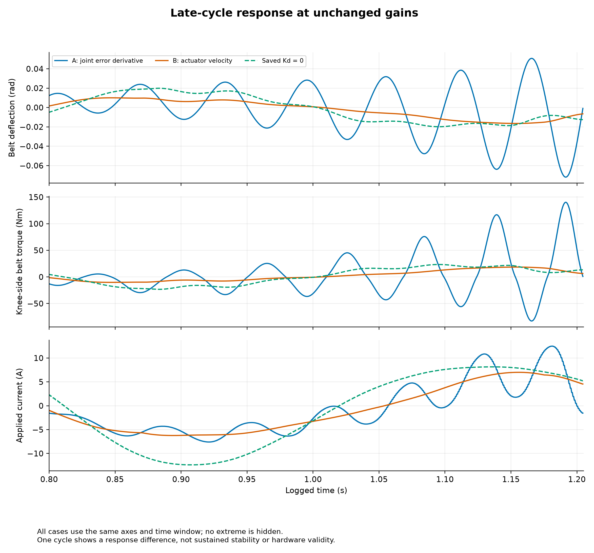
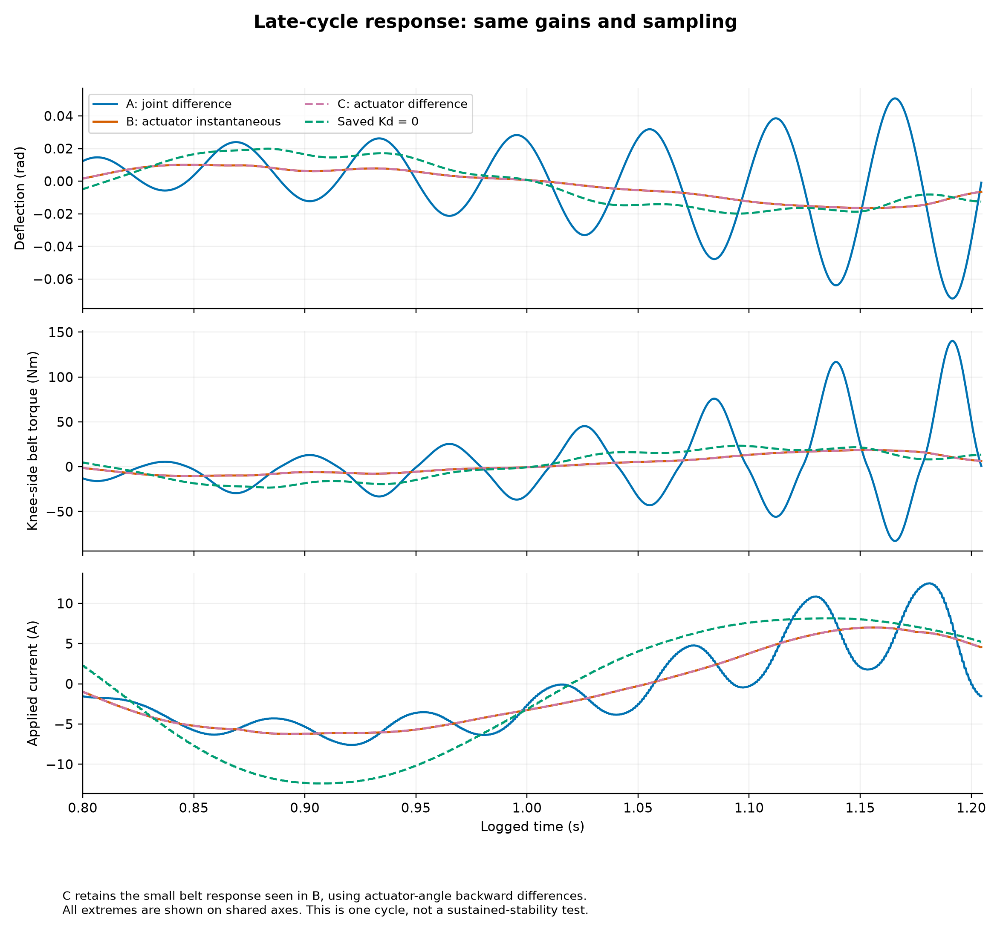
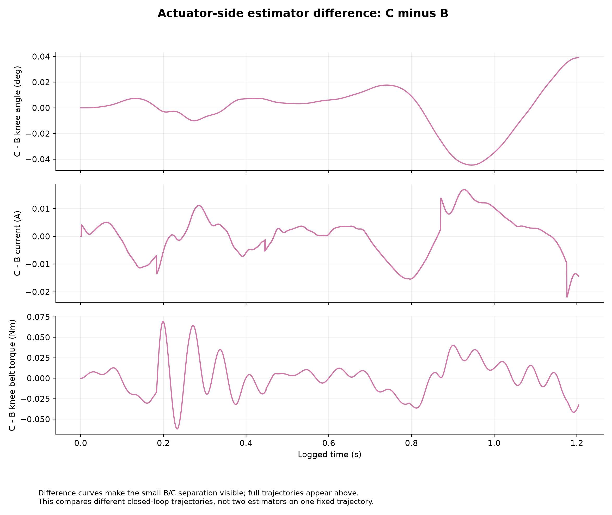
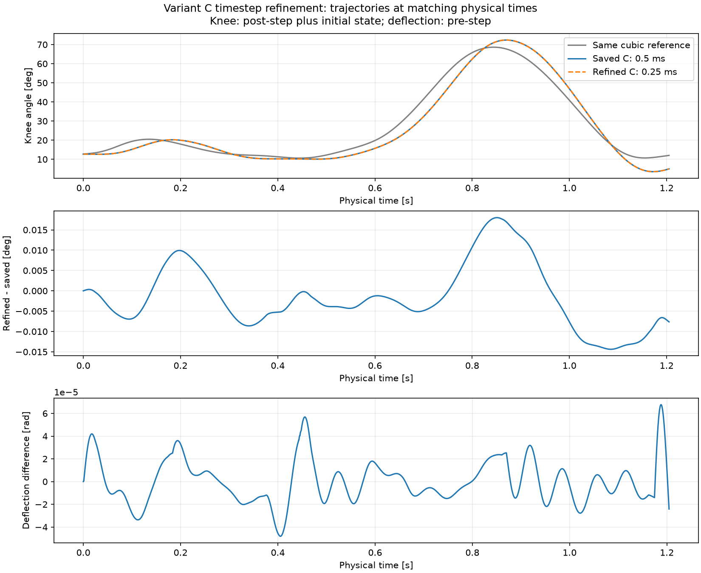
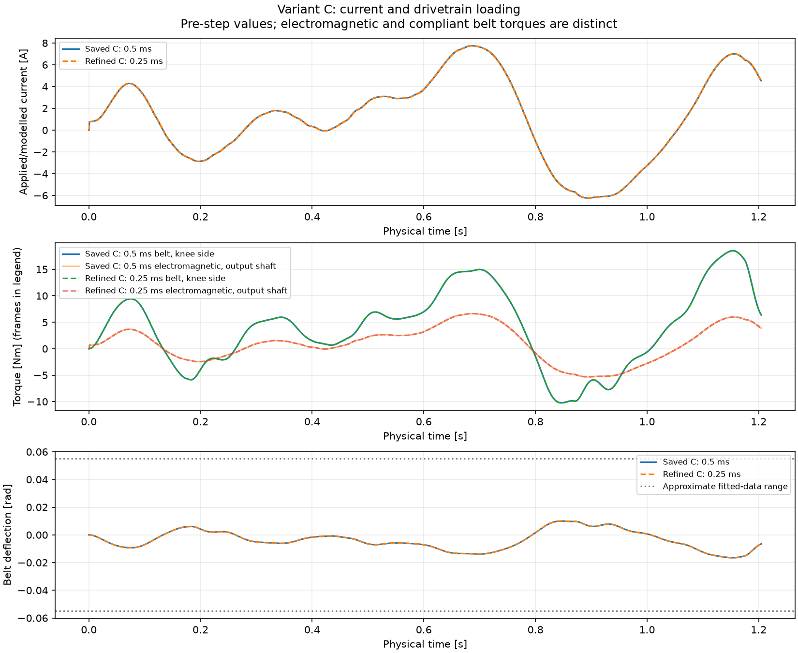

# Weekly progress: from current-controlled gait tracking to hardware-ready software boundaries

**Review date: 19 October 2026.** This report follows the work from the first current-controlled knee-gait experiment through the modular architecture checkpoint `267bcb8`. It summarizes completed work in sequence rather than assigning unverified dates to individual experiments.

**Main result:** we extended a current-controlled angle step experiment to a full human knee-gait reference. We then found that changing derivative feedback to the actuator side reduced peak simulated knee-side belt torque from **140.26 Nm to 18.51 Nm**, with similar tracking error. This result persisted when the physics timestep was halved. We integrated the selected method into live simulation and built replay, telemetry and software boundaries for later hardware work. **These are simulation and software results, not physical prosthesis validation.**

## 1. From a target-angle step to a complete gait cycle

Previously, the current-controlled ankle experiment tested the response to a change in target angle. We extended this approach to make the simulated knee follow the changing AB19 human knee-angle reference throughout one **1.205-second gait cycle**.

The flow was:

```text
Human knee-angle reference → current-domain controller → simulated motor/drivetrain
                          → simulated knee motion → feedback and recorded results
```

The controller produces current in amperes. The plant converts it into motor torque and then joint torque through a compliant belt model. The old knee position servo is disconnected in this path; it does not secretly assist tracking.

The initial configuration used Kp = **0.75 A/degree**, Kd = **0.03 A/(degree/second)** and Ki = 0, an ideal current loop, belt ratio **50/11**, a **1 ms controller period**, and **0.5 ms physics steps**. The knee started at the reference angle with zero velocity and zero belt deflection. The output-equivalent torque constant was **0.855 Nm/A**. These were working simulation assumptions, including gains transferred from the ankle experiment—not measured knee hardware settings.

The saved baseline completed 2,410 physics steps. Its RMS tracking error was **4.469°**, peak absolute tracking error **9.479°**, peak applied current **12.487 A**, and peak knee-side belt torque **140.265 Nm**. RMS is a whole-cycle error measure that gives greater weight to larger errors.

**Conclusion:** complete current-controlled gait tracking worked in simulation, but the late-cycle belt loading required investigation. Completing a run was not enough to call the model physically reliable.

Implementation: [gait entry point](../experiments/run_current_controlled_gait.py), [current gait controller](../oslbench/control/gait.py), and [simulation runtime](../oslbench/sim/current_gait.py).

## 2. Sensitivity comparison: what changes when gains or torque conversion change?

We compared **five existing saved runs**, with the same reference and time grid. The sensitivity analysis itself did not run a new simulation. Kp is the correction for angle error; Kd responds to how the error changes; KT converts current into torque.

| Saved case | RMS error (°) | Peak current (A) | Peak knee belt torque (Nm) | Maximum belt deflection (rad) |
|---|---:|---:|---:|---:|
| Baseline | 4.469 | 12.487 | 140.265 | 0.07196 |
| Remove derivative action: Kd = 0 | 7.696 | 12.389 | 23.324 | 0.01989 |
| Reduce Kp to 0.50 | 5.632 | 14.231 | 190.081 | 0.08729 |
| Use script KT: 0.5701 Nm/A | 6.616 | 11.260 | 37.448 | 0.02871 |
| Use paper KT: 0.9972 Nm/A | 4.139 | 44.847 | 1304.930 | 0.26789 |

All five traces completed the saved cycle without non-finite values, current clipping or joint-range violations. However, the baseline, lower-Kp and paper-KT cases exceeded the belt model's approximate **±0.055 rad fitted-data range**. That range describes the data used to fit the belt law; it is not a mechanical stop or a safety rating.



*Figure 1. Removing Kd increases the tracking error. A lower average error alone is not sufficient to select a configuration: the paper-KT curve has substantial late-cycle oscillation.*



*Figure 2. The baseline and lower-Kp cases leave the fitted-data range near the end. The paper-KT case goes far beyond it. The panels use different vertical scales; compare the axis values, not just the apparent heights.*

**What we learned:**

- Removing Kd reduced belt loading but worsened tracking; simply removing derivative action was not a satisfactory solution.
- Lowering Kp did not necessarily reduce loading. The changed motion and feedback produced higher peak current and belt torque.
- The paper-KT case had the lowest RMS error, but its approximately **1305 Nm** spring torque came from extrapolating the nonlinear belt law. It is not evidence that the hardware can generate this torque.
- Changing KT also changes the current-dependent friction through the existing conversion, so this was not a pure motor-gain comparison.

**Conclusion:** investigate the feedback signal itself before tuning gains further. Tracking error, current demand and the model's valid range must be considered together.

## 3. Feedback-location experiment: compare A and B at the same gains

The next question was whether the derivative term should use knee motion or actuator-side motion. Here, **A/B/C are feedback variants within the current-controlled gait experiment**. They are different from the repository's three overall control paths described in Step 9.

| Feedback variant | Signal used for derivative feedback | Plain-English meaning |
|---|---|---|
| **A: original baseline** | Change in knee tracking error over each 1 ms controller interval | Uses sampled knee motion and sampled reference motion. |
| **B: actuator velocity** | Simulated instantaneous actuator-output shaft velocity, divided by the belt ratio | Uses actuator motion to provide derivative feedback, while keeping knee-angle error for proportional control. |
| **C: actuator angle difference** | Change in actuator-output angle over each 1 ms interval, divided by the belt ratio | Introduced in Step 4 to use the same difference-based estimator type as A. |

For B and C, “actuator output” means the shaft after the planetary gearbox and before the belt. Dividing by the external belt ratio once expresses its motion in knee-equivalent coordinates. All three retain the reference-change contribution and suppress the derivative term at the first update.

We held gains, reference, plant, current conversion, initialization and timing fixed. A was checked against the original saved baseline before B was accepted for comparison.

| Result | A | B | Earlier Kd = 0 comparator |
|---|---:|---:|---:|
| RMS error (°) | 4.469 | 4.539 | 7.696 |
| Peak applied current (A) | 12.487 | 7.743 | 12.389 |
| Peak knee belt torque (Nm) | 140.265 | 18.506 | 23.324 |
| Maximum belt deflection (rad) | 0.07196 | 0.01649 | 0.01989 |



*Figure 3. B preserves broadly similar tracking to A and performs substantially better than removing Kd altogether. The remaining reference-tracking error is still visible.*



*Figure 4. The large late-cycle belt oscillations in A are strongly reduced in B, without changing gains or adding a torque clamp.*

B reduced peak belt torque by **86.81%** and peak current by **37.99%**; RMS error increased by **1.58%**. B stayed inside the fitted-data range for this cycle.

**Conclusion:** actuator-side feedback was promising. However, A and B changed both the feedback location and the way velocity was obtained. A/B alone could not tell us which change mattered most.

Execution detail: the first comparison stopped because its checker incorrectly treated metadata rows as missing numerical metrics. The checker was corrected; saved A passed the reproduction check before B ran. This historical failure was not silently counted as a successful experiment. See [A/B runner](../experiments/run_gait_feedback_location_ab.py).

## 4. Estimator comparison: introduce C to separate the two effects

We introduced C, which estimates actuator velocity from successive actuator angles **1 ms apart**, instead of reading instantaneous simulated velocity. This made A and C comparable in estimator type while changing the feedback location. B and C then compared two velocity methods at the same actuator-side location.

Only C was newly simulated in this phase; A, B and Kd = 0 were reused from saved results.

| Result | A: knee difference | B: actuator velocity | C: actuator difference |
|---|---:|---:|---:|
| RMS error (°) | 4.4687 | 4.5391 | 4.5237 |
| Peak current (A) | 12.4871 | 7.7430 | 7.7449 |
| Peak knee belt torque (Nm) | 140.2647 | 18.5063 | 18.5068 |
| Maximum belt deflection (rad) | 0.07196 | 0.01649 | 0.01649 |



*Figure 5. B and C nearly overlap. C retains the reduced loading even though it uses an angle-difference velocity estimate.*



*Figure 6. The differences are small but not zero: maximum absolute C–B knee-angle difference is about **0.0446°**, and maximum current difference is about **0.0219 A**. These are differences between two closed-loop runs, not errors against measured physical velocity.*

**Conclusion:** for this configuration, feedback location is the stronger explanation for the large loading reduction. Access to instantaneous simulated velocity was not necessary to obtain it. This supports C as a candidate, but does not prove a universal stability result.

Implementation: [estimator-comparison runner](../experiments/run_gait_feedback_location_estimator.py) and [feedback laws](../oslbench/control/feedback.py).

## 5. Timestep test: does C still work with finer physics integration?

We halved the physics timestep from **0.5 ms to 0.25 ms**, keeping the controller period at **1 ms**. The refined run therefore used four physics steps per controller update instead of two. Both completed the same 1.205-second cycle with 1,205 controller updates.

We also corrected the *comparison timing*: historical rows label post-step knee angles with the pre-step timestamp. For convergence analysis, the reference and knee angle were compared at matching physical times. This is why the following RMS values differ from the historical 4.5237° result; the controller did not change.

| Measure | C at 0.5 ms | C at 0.25 ms | Change |
|---|---:|---:|---:|
| RMS tracking error at common physical times (°) | 4.58358 | 4.58659 | +0.0656% |
| Peak applied current (A) | 7.74485 | 7.74925 | +0.0568% |
| Peak knee belt torque (Nm) | 18.50676 | 18.52741 | +0.1116% |
| Maximum belt deflection (rad) | 0.0164947 | 0.0165098 | +0.0915% |
| Physics steps | 2,410 | 4,820 | Doubled |



*Figure 7. The trajectories nearly overlap. The lower panels reveal small differences; the largest knee-angle difference is approximately **0.0180°**.*



*Figure 8. Low loading persists at the finer step. Neither run leaves the fitted-data range. Electromagnetic output-shaft torque and knee-side belt torque are different quantities, not interchangeable measurements.*

**Conclusion:** C's lower loading is robust to this timestep refinement for the tested cycle. Two timesteps do not establish a convergence rate or long-term stability. A 0.125 ms test remains a possible next check; it is not a completed result.

Implementation: [timestep runner](../experiments/run_gait_feedback_location_timestep.py).

## 6. Integrate C with live visualization and saved results

C became selectable in the regular gait application through `--feedback-mode actuator-difference`. The original `legacy` feedback remains the default. The native MuJoCo viewer, browser dashboard and CSV logger consume the same simulation execution, rather than separately simulated trajectories.

The completed visible demonstration reproduced all **29 shared trace columns exactly over 2,410 steps** against the diagnostic C run, according to the saved full-precision parity checks. Its RMS error was **4.5237°**, peak current **7.7449 A**, and peak knee belt torque **18.5068 Nm**. Pause, stop, completion and per-attempt saving were added; partial attempts are marked separately.

An earlier launch stopped while paused at time zero because the native window was not visible. It is preserved as a zero-step attempt and is **not** the completed demonstration. The later visible run completed one cycle; it was still a simulated prosthesis, not a physical leg.

**Conclusion:** the selected control method could be observed and logged through one consistent live simulation pipeline. See [live demonstration guide](LIVE_DEMO.md).

## 7. Build trustworthy replay and live-data foundations

We then prepared the software to handle observations without confusing them with control commands.

| Step | Work completed | Conclusion |
|---|---|---|
| Typed state and commands | Added explicit units, coordinates, times, validity and separate position/torque/current types. A canonical C run retained exact 29-channel parity with the live result. | Current, torque and position cannot be treated as the same command. |
| Deterministic replay | Exported seven state channels into **16,870 observations across 2,410 groups**, retaining their correct pre/post-step times. Added validation, reset and replay-clock handling. | Saved data can be inspected without rerunning physics. |
| Replay dashboard | Added play/pause, timestamp stepping and speed controls; preserved missing, invalid and held values. | Presentation does not imply a new simulation. A full robot pose is not invented from incomplete channels. |
| Mock live telemetry | Tested asynchronous arrivals, missing/invalid values, stale data and disconnects through a read-only source interface. | Receipt time and source time must remain distinct. |
| Shared schema and formatting | Extracted shared observation definitions and formatting from replay-specific modules. | Real telemetry need not depend on replay implementation details. |

**Conclusion:** replay and mock data established the behavior needed before connecting a real sensor. They do not constitute hardware measurements. See [replay](TELEMETRY_REPLAY.md) and [telemetry source](TELEMETRY_SOURCE.md) documentation.

## 8. Team inputs and the IMU-to-laptop pipeline

**Praveen's M.Tech-side input:** the reported setup is a **MicroStrain 3DM-GV7-AR connected by USB to a Raspberry Pi 5**, using MIP, with Euler angles and quaternions previously obtained at approximately **20 Hz**. He had a Flask live-plotting application, but usable code was not available for this implementation. The exact library, fields, conventions and timestamps still require verification. These are supplied setup details, not measurements independently confirmed in this work.

**Pritam's architecture contribution:** the supplied PhD-side proposal described interchangeable simulation and hardware wrappers, with control logic separated from backend-specific sensor reading and actuation. We used that principle while keeping position, torque and current contracts distinct. The available material is the supplied description of the proposal; it is not evidence that a complete interchangeable hardware backend already exists. Pritam's motor-control measurements remain a separate source with no verified interface integrated here.

The implemented sensor-data path is:

```text
MicroStrain IMU → passive Pi reader → read-only HTTP service
               → laptop telemetry client → browser presentation
```

The Python acquisition adapter uses MSCL decoded fields. The existing project documentation records why MSCL was selected for this phase and why a MIP SDK bridge may be preferable later. The service uses the Python standard-library HTTP server; it does not claim to reuse the unavailable Flask application. Acquisition runs independently of HTTP requests, and the laptop client handles network work outside presentation polling.

Software tests cover synthetic reader data, JSON validation, timestamps, duplicate responses, stale data, malformed payloads, timeouts, disconnects and shutdown using a local server/client. Repeated HTTP responses do not turn an old observation into a fresh one. No motor command interface was added.

**Conclusion:** the telemetry software is implemented and tested with injected readers and local HTTP. Real Pi installation, USB reading, actual sensor rate, mounting, orientation conventions and latency remain unvalidated. The 20 Hz client polling default is not proof of a 20 Hz sensor stream. See [IMU integration guide](IMU_TELEMETRY.md).

## 9. Put the modular architecture into the source tree

The directory separation is now **implemented**, not just proposed:

```text
oslbench/
  contracts.py, telemetry_schema.py   Shared meanings, units and observations
  control/                           Controllers and drivetrain equations
  sim/                               MuJoCo model access and physics execution
  telemetry/                         Sensor reader, HTTP, replay and mocks
  presentation/                      Viewers, dashboards and formatting
  apps/                              Application composition and future IMU handoff
experiments/                         Existing experiment launch commands
tests/                               Regression and boundary checks
docs/                                Guides and this report
build/                               Local generated evidence; not published wholesale
```

The three overall **control paths** remain separate: **Path A** is the original position-servo benchmark; **Path B** is torque-domain PD with the compliant drivetrain; **Path C** is the current-domain gait follower. Feedback **variants A/B/C in Steps 3–5 all belong to the current-domain work**; the labels do not identify the same thing.

Legacy module imports and launch commands remain compatible. The live gait viewer now imports a library runtime rather than an experiment script. Model assets, references and historical evidence stayed in place.

Two future hardware workflows have explicit, separate boundaries:

- **D1 — physical prosthetic mirroring:** the physical prosthesis runs its own controller. A read-only helper can display a valid, calibrated measured knee-encoder angle through kinematics without advancing physics or sending commands. A real encoder adapter and calibration are still missing.
- **D2 — IMU-driven simulation:** measured IMU observations must pass through an explicitly supplied estimator/reference generator before a simulated controller can use them. The handoff exists, but no validated estimator or automatic simulation connection is implemented. An IMU quaternion is not assumed to be knee angle.

**Conclusion:** the code has clearer ownership and a foundation for compatible backends, but this is not yet a complete hardware-connected digital twin. See [architecture](ARCHITECTURE.md) and [control paths](CONTROL_PATHS.md).

## 10. Validation, limitations and the next work

Saved final logs were inspected, not just script names. They record **201** passing tests after A/B, **209** after C, **210** after timestep refinement, **216** after live integration, **222** after typed contracts, **231** after replay, **238** after replay presentation, **244** after mock telemetry, and **258** after IMU transport. Historical oracle logs for the feedback, timestep, live and contract milestones report successful reproduction of the original benchmark. The oracle is a simulation regression reference, not hardware ground truth.

For this report, the current full suite was rerun using `.venv/Scripts/python.exe tests/run_tests.py`: **263 passed, 0 failed, 0 skipped**, using real MuJoCo. “Real MuJoCo” means the actual physics engine rather than a test stub; it does not mean real hardware. These tests include established short simulation checks. No new standalone gait, sensitivity, convergence or oracle experiment was run for this report.

Earlier failed checks remain part of the record: besides the A/B metadata-check issue and zero-step viewer attempt, the first C focused test had a frozen-test-object setup error, and the first contract full run exposed two direct-iterator compatibility failures. Corrected final runs passed; the report uses those final outcomes rather than treating every historical invocation as successful.

**Limits that still matter:** the main comparisons cover one fixed-base gait cycle, not sustained walking or human stance loading. The current loop is ideal; motor constants, friction and belt parameters are not calibrated to this physical rig. Gains are provisional. Apparent waveform lag is not measured driver/network latency. The fitted-data range is not a safety limit. No physical current, encoder, torque or IMU measurements were validated in this work.

**Next steps, in order:**

1. Obtain Praveen's usable reader/Flask code or a documented sample payload, and record the Pi OS, Python, sensor firmware and enabled fields. Confirm the actual acquisition library and rate on the device.
2. Validate the read-only sensor pipeline on the Pi and laptop: values, units, frames, mounting, source timestamps, buffering, stale streams, unplug/restart and shutdown behavior.
3. Obtain Pritam's documented motor/encoder measurement interface and command semantics. Keep this separate from passive IMU telemetry; do not infer encoder position from a motor command.
4. For D1, calibrate real encoder readings into knee coordinates. For D2, define and validate the orientation/gait estimator and reference generator before connecting it to simulation.
5. Extend simulation evidence with repeated cycles, realistic loading, parameter uncertainty and current-loop dynamics. If a convergence-rate claim is needed, add the proposed 0.125 ms test with the controller period unchanged.
6. Only after synchronized, calibrated measurements exist, compare measured and predicted motion/loading to assess a digital twin.

## Evidence and figure provenance

The headline RMS/current/belt-torque values were independently recomputed from ten saved traces for this report: the five sensitivity cases, A, B, C, refined C and the completed visible C run. Row counts were checked and all numeric cells in these traces were finite. The timestep common-time results and historical parity claims above are taken from the corresponding saved analyses and validation records. Early gait metadata does not contain complete historical source hashes; current source inspection alone cannot authenticate its original source version.

The eight figures below are byte-for-byte copies of the original PNGs, selected after visual inspection. They are stored alongside this report under `docs/assets/weekly_gait_report/`, so GitHub can display them without publishing `build/`. The paths in this table identify the local evidence; the report and its images do not depend on those ignored files being available to the reader.

| Figure | Original path beneath `build/` |
|---|---|
| 1 | `gait_investigation/01_knee_angle.png` |
| 2 | `gait_investigation/04_belt_deflection.png` |
| 3 | `gait_feedback_location_ab/01_tracking.png` |
| 4 | `gait_feedback_location_ab/05_late_cycle.png` |
| 5 | `gait_feedback_location_estimator_ab/05_late_cycle.png` |
| 6 | `gait_feedback_location_estimator_ab/06_estimator_difference.png` |
| 7 | `gait_feedback_location_timestep_convergence/01_common_time.png` |
| 8 | `gait_feedback_location_timestep_convergence/02_loading.png` |

Numerical and execution evidence: `build/gait_investigation/GAIT_SENSITIVITY_COMPARISON.md`; `build/gait_feedback_location_ab/FEEDBACK_LOCATION_COMPARISON.md`; `build/gait_feedback_location_estimator_ab/FEEDBACK_LOCATION_ESTIMATOR_COMPARISON.md`; `build/gait_feedback_location_timestep_convergence/TIMESTEP_CONVERGENCE_REPORT.md`; their traces, comparison CSVs and final test/oracle logs; `build/integrated_current_gait_phase5/PHASE5_REPORT.md` and `visible_live_run/attempt_001/`; and the `REPORT.md` and final test logs in `build/phase6c_contracts/`, `phase6d_replay/`, `phase6e_replay/`, `phase6f_foundation/` and `phase6fb_telemetry/`.

Reviewed checkpoints: `64a5ce3` (contracts/replay/mock foundation), `2fe87ca` (shared schema/formatting), `9543fad` (IMU telemetry pipeline), and `267bcb8` (modular architecture). Publishing this report requires only this Markdown file and its eight image assets; no implementation or generated run directory needs to be included.
