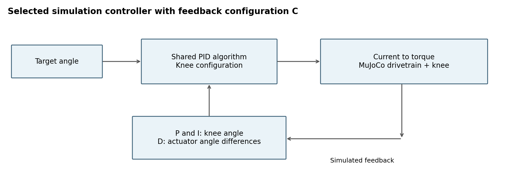
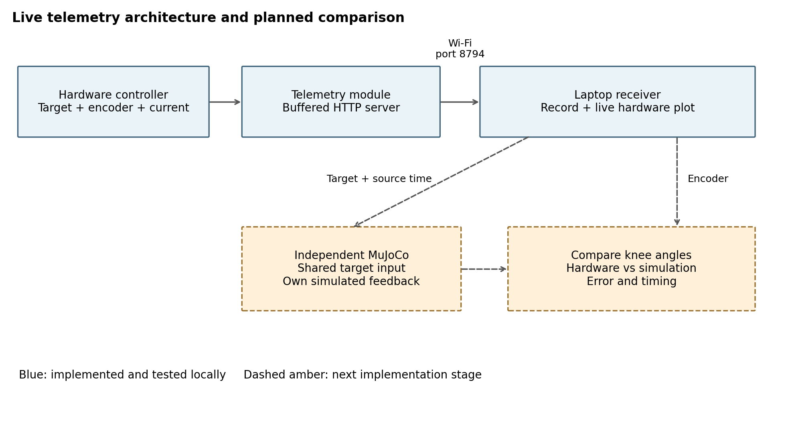

# Weekly progress on knee control and hardware telemetry

**Review date: 26 October 2026.** This report continues last week's gait-tracking report. We separated the knee and ankle tuning, compared the knee gains in simulation, and prepared a live encoder-data connection for the physical step test.

**Main result:** at matched simulation settings, the supplied knee gains reduced RMS tracking error by about **50%**. The telemetry software has passed local tests, but the physical connection and independent hardware–simulation comparison are still pending.

## 1. Introduce the knee controller while preserving the baseline

Last week's knee experiment used ankle-derived gains. We kept those settings as the ankle configuration and added a knee configuration. Both use the same PID implementation, MuJoCo model, simulation runtime and gait dashboard. This lets us select a controller without maintaining separate copies of the system.

| Setting | Preserved ankle profile | Selected knee profile |
|---|---:|---:|
| Kp in A/degree | 0.75 | 1.5 |
| Ki in A/(degree second) | 0 | 0.15 |
| Kd in A/(degree/second) | 0.03 | 0.06 |
| Integral limit | Inactive with Ki = 0 | 50 degree-seconds |
| Controller update rate | 1,000 Hz | 200 Hz |
| Assumed output torque constant | 0.855 Nm/A | 0.5701 Nm/A |
| Feedback | Original knee-side feedback | Configuration C |

The knee gains, integral limit and update rate come from the supplied step controller. The torque constant remains a provisional simulation assumption: its physical shaft and current definition still need confirmation.

*Figure 1. Configuration C keeps knee-angle feedback for P and I. D uses successive actuator-side angles, converted through the transmission ratio.*

We retained C because the simulated knee-side derivative produced large belt oscillations, including with the new gains. The supplied hardware controller uses knee-error differences for D. Therefore, our selected simulation configuration is not yet an exact copy of the hardware control law.

## 2. Compare performance under the same conditions

To isolate the tuning change, both cases below use C feedback, 200 Hz control, the same assumed 0.5701 Nm/A conversion, the same AB19 knee-angle reference and the same model. Physics steps remain 0.5 ms. These are saved results for one 1.205-second cycle.

| Measure | Ankle-derived gains | Knee gains |
|---|---:|---:|
| RMS tracking error | 6.846° | **3.394°** |
| Peak tracking error | 13.465° | **7.055°** |
| Best-fit phase lag | 35.5 ms | **15.5 ms** |
| Peak joint-side belt and knee drive torque | 19.472 Nm | 19.042 Nm |
| Peak requested and applied current | 11.161 A | 12.372 A |
| Current clipping | None | None |

*Figure 2. The knee gains follow the reference more closely and reduce the error, with slightly higher peak current. The curves come from preserved simulation recordings.*

The best tested C case reached **2.186° RMS**, but used 1,000 Hz and 0.855 Nm/A. We keep it as a separate numerical result rather than claiming it represents the hardware. We also cannot assign the improvement to Ki alone because Kp and Kd changed at the same time.

## 3. Build the live encoder telemetry pipeline

We chose encoder telemetry because the hardware controller already reads knee angle for feedback. This avoids adding a second encoder reader or first solving IMU-to-joint-angle reconstruction.

*Figure 3. The blue path is implemented. The dashed path is the planned independent MuJoCo comparison.*

The implementation follows these steps:

1. **Read and control on the hardware host.** The existing controller generates its target, reads the knee encoder and calculates motor current.
2. **Publish a copy of each control sample.** The separate `knee_telemetry.py` module buffers source timestamps, target angle, encoder angle, requested/clamped current and encoder validity. Network work runs outside the control loop; publishing does not wait for the buffer lock.
3. **Receive on the laptop.** The laptop fetches batches over Wi-Fi from port 8794 using a shared token. Sequence numbers reveal gaps and session IDs distinguish separate runs.
4. **Save and display.** The receiver saves the samples and plots target versus measured angle. A reused encoder reading is marked invalid instead of presented as a fresh measurement.

The complete modified step controller and the separate telemetry module have been packaged and shared. The original gains, motor commands, guards and CSV logging are preserved. We start with the supplied one-second step test before modifying the main gait controller.

Live telemetry comes directly from the controller, not from its CSV. CSV replay and synthetic telemetry remain separate tools for testing the software without hardware. Commanded current is not measured motor current, and encoder angle alone does not measure joint torque.

## 4. Verify the software and improve the display

A 50-second local synthetic test recorded **10,073 samples with no gaps or duplicates**. The latest connection suite passed **12 tests**. These checks cover software behaviour, not the physical Wi-Fi connection or motor operation.

We also corrected repeated rebuilding of graph and table elements in the older multi-graph dashboard. It now updates existing elements in place. All **8 replay/UI tests** passed, including 500 updates of eight graphs without recreating them. Manual scrolling should still be checked on the presentation computer.

The current hardware-telemetry command opens a browser graph; it does **not** launch MuJoCo. The independent simulation connection is the next implementation stage.

## 5. Next steps

1. Test synthetic traffic across the actual Wi-Fi, then run the physical step test. Check sample counts against the hardware CSV, especially the final samples at shutdown.
2. Confirm the encoder sign/calibration, actual control timing, torque-current conversion and physical bench load.
3. Feed the shared target into MuJoCo using source timestamps. Let the simulation use its own feedback; compare its knee angle with the measured hardware angle on one graph.
4. Match or explicitly separate the controller-law differences before interpreting the result as a plant gap. Then extend to the main gait controller and longer runs.

Viewer smoothness and tracking phase lag will be checked separately. Display optimization should preserve the physics timestep, controller timing and recorded samples.

**Evidence:** [controller comparison](KNEE_CONTROLLER_COMPARISON.md), [selected-profile results](../build/knee_controller_selection/comparison.json), [hardware instructions](../hardware/README.md), and [meeting demo commands](MEETING_DEMO_COMMANDS_2026-10-26.md).
